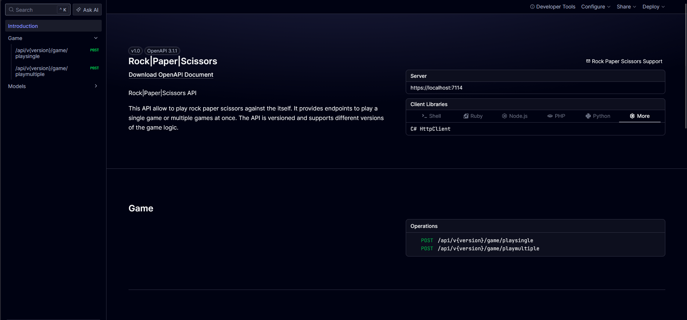
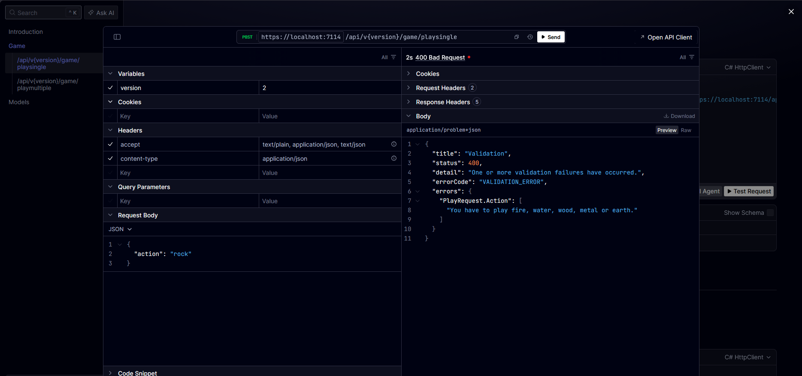
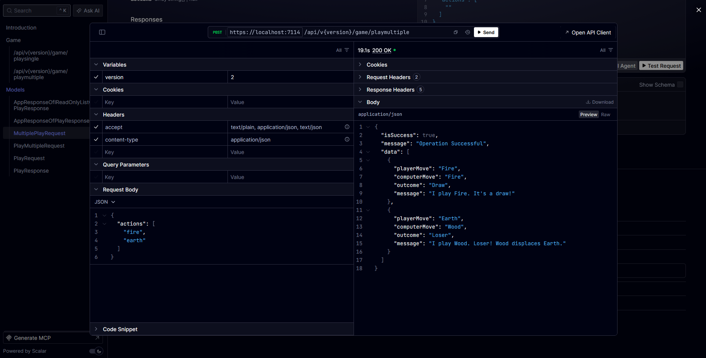

# Rock Paper Scissors API (Wu Xing Edition)

A modernized .NET Web API built with Clean Architecture, CQRS (MediatR), and API Versioning. This repository contains the solution to the 5-way elemental variant of Rock-Paper-Scissors featuring **Fire, Water, Wood, Metal, and Earth**.

## Rules
- Fire burns Wood and melts Metal
- Wood displaces Earth and absorbs Water
- Water extinguishes Fire and rusts Metal
- Earth extinguishes Fire and absorbs Water
- Metal cuts Wood and displaces Earth

## Features
- **Clean Architecture:** Strict boundary enforcement using `NetArchTest`. The Domain layer has zero dependencies on Features or Infrastructure.
- **Dynamic Phrasing:** The game engine uses configurable GameOptions prefix/suffix templates (e.g., WinnerTemplate, LoserTemplate, DrawTemplate), making the outcome phrasing customizable via appsettings.json.
- **CQRS Pattern:** Requests are cleanly separated and handled using MediatR.
- **API Versioning:** Fully supports multiple versions of the game endpoints (`v1` and `v2`).

## API Endpoints

The API provides interactive API documentation using Scalar.



### 1. Play Single (`v2`)
Play a single round of the elemental Rock-Paper-Scissors game against the computer.

**`POST`** `/api/v2/game/playsingle`
```json
{
  "action": "metal"
}
```

**Example Response:**


### 2. Play Multiple (`v2`)
Play multiple rounds at once by providing a list of actions.

**`POST`** `/api/v2/game/playmultiple`
```json
{
  "actions": ["fire", "earth"]
}
```

**Example Response:**

