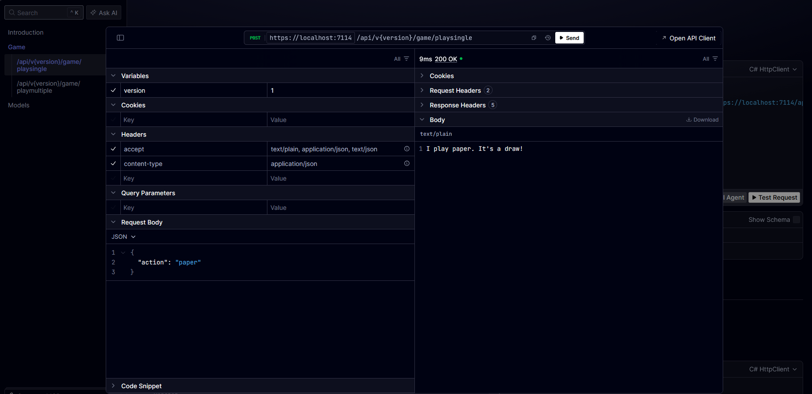
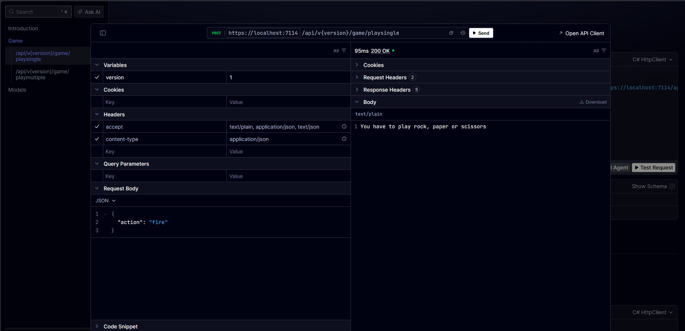
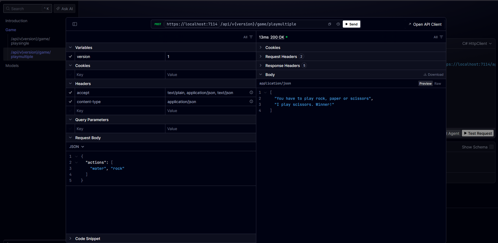

# Rock Paper Scissors API (Wu Xing Edition)

A modernized .NET Web API built with Clean Architecture, CQRS (MediatR), and API Versioning. This repository contains the solution to the 5-way elemental variant of Rock-Paper-Scissors featuring **Fire, Water, Wood, Metal, and Earth**.

## Rules
- Fire burns Wood and melts Metal
- Wood displaces Earth and absorbs Water
- Water extinguishes Fire and rusts Metal
- Earth extinguishes Fire and absorbs Water
- Metal cuts Wood and displaces Earth

## Features
- **Clean Architecture:** Strict boundary enforcement using `NetArchTest`. The Domain layer has zero dependencies on Features or Infrastructure.
- **Dynamic Phrasing:** The game engine uses configurable GameOptions prefix/suffix templates (e.g., WinnerTemplate, LoserTemplate, DrawTemplate), making the outcome phrasing customizable via appsettings.json.
- **CQRS Pattern:** Requests are cleanly separated and handled using MediatR.
- **API Versioning:** Fully supports multiple versions of the game endpoints (`v1` and `v2`).

## API Endpoints

The API provides interactive API documentation using Scalar.


### 1. Play Single (`v2`)
Play a single round of the elemental variant Fire-Water-Wood-Metal-Earth game against the computer.

**`POST`** `/api/v2/game/playsingle`
```json
{
  "action": "rock"
}
```

**Example Response:**


### 2. Play Multiple (`v2`)
Play multiple rounds at once by providing a list of actions.

**`POST`** `/api/v2/game/playmultiple`
```json
{
  "actions": ["fire", "earth"]
}
```

**Example Response:**


### 3. Play Single (`v1` Legacy)
Play a single round of the classic Rock-Paper-Scissors game against the computer using the backward-compatible v1 API.

**`POST`** `/api/v1/game/playsingle`
```json
{
  "action": "paper"
}
```

**Example Response:**


**Invalid Input Example:**


### 4. Play Multiple (`v1` Legacy)
Play multiple rounds of classic Rock-Paper-Scissors at once.

**`POST`** `/api/v1/game/playmultiple`
```json
{
  "actions": ["water", "rock"]
}
```

**Example Response:**


## Getting Started

### 1. Preparing the Environment
This project uses **MediatR** configured with a required license key parameter. Before running the application, you must set the `MediatR:LicenseKey` to `Community` using .NET User Secrets to keep the key out of source control.

**Using the Terminal:**
Navigate to the API project directory and initialize the secrets:
```bash
cd src/Services/RockPaperScissors/Rps.Api.Http
dotnet user-secrets init
dotnet user-secrets set "MediatR:LicenseKey" "Community"
```

**Using Visual Studio:**
1. Right-click the `Rps.Api.Http` project in the Solution Explorer.
2. Select **Manage User Secrets**.
3. Add the following JSON:
   ```json
   {
     "MediatR": {
       "LicenseKey": "Community"
     }
   }
   ```

### 2. Cloning the Repository
Clone the repository to your local machine:
```bash
git clone <repository-url>
cd <repository-directory>
```

### 3. Running the Application
You can launch the API server from the terminal or using your preferred IDE.

**Using the Terminal:**
From the root of the cloned repository, run:
```bash
dotnet run --project src/Services/RockPaperScissors/Rps.Api.Http/Rps.Api.Http.csproj
```

**Using Visual Studio or Rider:**
1. Open the solution file.
2. Set `Rps.Api.Http` as the Startup Project.
3. Press `F5` (or click Run/Start) to build and launch the application.

### 4. Accessing the Browser Documentation
Once the application is running, the interactive API documentation (Scalar) will be available in your browser. 
Depending on the port assigned to your environment, navigate to:
- `http://localhost:<port>/scalar/v2` (for V2 endpoints)
- `http://localhost:<port>/scalar/v1` (for V1 endpoints)

### 5. How to Test
The solution includes a comprehensive suite of Unit Tests, Integration Tests, and Architecture Enforcement tests.

**Using the Terminal:**
From the root of the repository, execute:
```bash
dotnet test
```

**Using Visual Studio or Rider:**
1. Open the **Test Explorer** window.
2. Click **Run All Tests** to execute the entire suite.

---

### Reviewing the Solution
If you are reviewing this codebase, we highly recommend reading the comprehensive [Refactoring Document](docs/REFACTORING.md). It details the architectural shifts, performance improvements, and bug fixes made during the modernization process from the legacy V1 API to the clean architecture V2 API.
